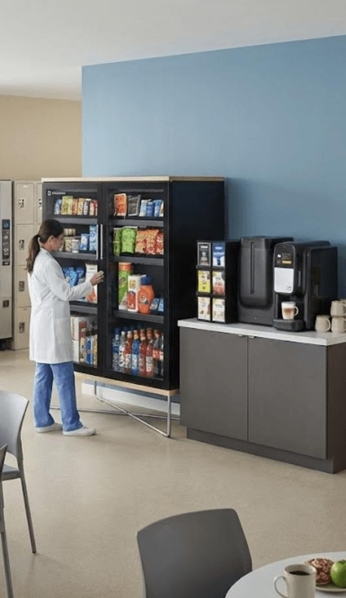

import SchemaMarkup from '../../components/SchemaMarkup.astro';
import { faqPageSchema } from '../../lib/schema';

export const faqs = [
	{
		question: 'Do hospitals qualify for free vending or smart cooler placement?',
		answer:
			'Yes, if the location has at least 50 people in total foot traffic, counting employees and visitors. Texas Vending then places equipment at no cost. Large campuses may support several placements, and a smaller clinic may qualify for one compact setup.',
	},
	{
		question: 'Can night-shift healthcare staff buy fresh food after the cafeteria closes?',
		answer:
			'Yes. Smart coolers and micro markets are self-service and cashless, so staff can buy sandwiches, salads, and drinks at any hour without a cashier.',
	},
	{
		question: 'How fast are vending problems fixed at a hospital?',
		answer:
			'Texas Vending responds to reported service issues within 24 hours, including after hours.',
	},
];

<SchemaMarkup schema={faqPageSchema(faqs)} />

**Short answer:** Dallas healthcare vending works best when each department gets its own plan. Staff-only areas can support fresh food in smart coolers or micro markets. Public waiting areas usually do better with cashless snack and drink machines. Placement, restocking, and service access matter more than the size of the building.

Dallas healthcare facilities do not run on one schedule. Nurses arrive before sunrise, technicians work late, families wait near patient units, and administrative teams keep office hours. One machine near the main entrance will not serve every department or shift.

## Hospitals, Clinics, and Medical Offices Need Different Plans

### Hospital Campuses Serve Several Audiences

Large campuses, like those in the Southwestern Medical District along Harry Hines Boulevard, mix public entrances, secured clinical areas, staff lounges, emergency departments, medical offices, and loading docks. Each area has different users and different hours.

For example, picture a staff lounge near the emergency department and a public waiting area near outpatient surgery. The overnight nurse needs a sandwich, yogurt, or water after the cafeteria closes. A family member may only want a bottled drink and a packaged snack. The lounge can support [fresh food](/fresh-food/), while the waiting area may work better with an enclosed cashless machine.

### Clinics and Medical Office Buildings Need Less, Placed Well

A clinic or medical office building usually has one shared break room and regular hours. A compact [AI smart cooler](/our-services/ai-smart-cooler/) or a single [vending machine](/our-services/vending-machine/) often covers it. The key question is not square footage. It is how many people will use the equipment, and when.

## Choosing Equipment and Food for Healthcare Staff

### Smart Coolers for Secured Staff Areas

Smart coolers unlock with a card or phone and charge automatically when someone takes an item. That makes them a good fit for a badge-access staff lounge: fresh meals, no cashier, and no line.

### Micro Markets for Larger Staff Dining Areas

A larger employee dining space may support a [micro market](/our-services/micro-markets/) with open shelves, refrigerated cases, and self-checkout that stays open around the clock. In Texas, micro markets are licensed as [Self-Service Food Markets](https://www.dshs.texas.gov/retail-food-establishments/general-faqs-retail-food-establishments/self-service-food-market), a type of retail food establishment.

### Fresh Food Needs Disciplined Handling

Prepared sandwiches, salads, yogurt, and wraps cannot be treated like shelf-stable snacks. They need refrigeration, date checks, rotation, and cleaning. Real-time monitoring tells the Texas Vending team when a cooler or market needs service. If the night shift keeps finding empty sandwich rows, the restocking schedule needs to change.

## Coffee Demand Follows Departments and Shifts

Healthcare teams use coffee differently across a campus. Administrative staff create heavy morning demand, surgery teams arrive earlier, and overnight staff want coffee after dining closes. A [coffee and water service](/our-services/coffee-water/) plan should match brewer size to each department. For example, one small brewer in a 100-person department creates lines, while an oversized system in a quiet clinic wastes supplies.

## Placement Must Respect Clinical Operations

Equipment should never block an accessible route or sit beside sensitive patient-care activity. Route drivers may need badges, loading-dock appointments, elevator access, and approval to cross restricted areas. Texas Vending walks the site before recommending equipment, and plans service visits around shifts, docks, and badge rules.

Departments relocate and lounges get renovated. When that happens, equipment needs to be [moved, leveled, connected, and tested](/our-services/vending-moving/). Plan the move with your provider before construction starts.

## What to Expect From Texas Vending

- **No cost to qualify:** equipment, delivery, and setup are free at locations with at least 50 people in total foot traffic, counting employees and visitors.
- **No long-term contract.**
- **24-hour response** to reported service issues, including after hours, from local technicians.
- **Cashless payment** on every machine and market: cards, mobile wallets, and tap-to-pay.
- **Restocking set per location**, with product changes based on what staff buy.

Comparing providers? Our [vending contract checklist](/blog/vending-contract-checklist/) lists the questions to ask before you sign.

## Frequently Asked Questions

{faqs.map((faq) => (
	<>
		<h3>{faq.question}</h3>
		
{faq.answer}

	</>
))}

## Schedule a Healthcare Site Review

Texas Vending will review your employee count, visitor traffic, shift coverage, break room layout, and service access, then recommend the right mix of vending, smart coolers, micro markets, and coffee. [Book a free site visit](/contact-us/) for your Dallas hospital, clinic, or medical office building.

### Sources

- Texas Department of State Health Services, [Self-Service Food Market FAQs](https://www.dshs.texas.gov/retail-food-establishments/general-faqs-retail-food-establishments/self-service-food-market)
